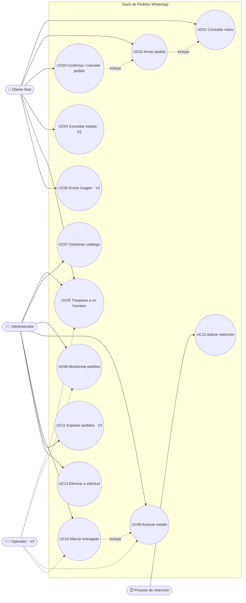
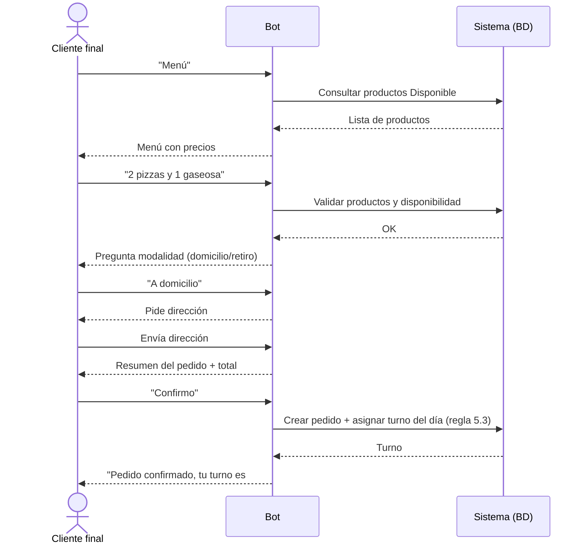
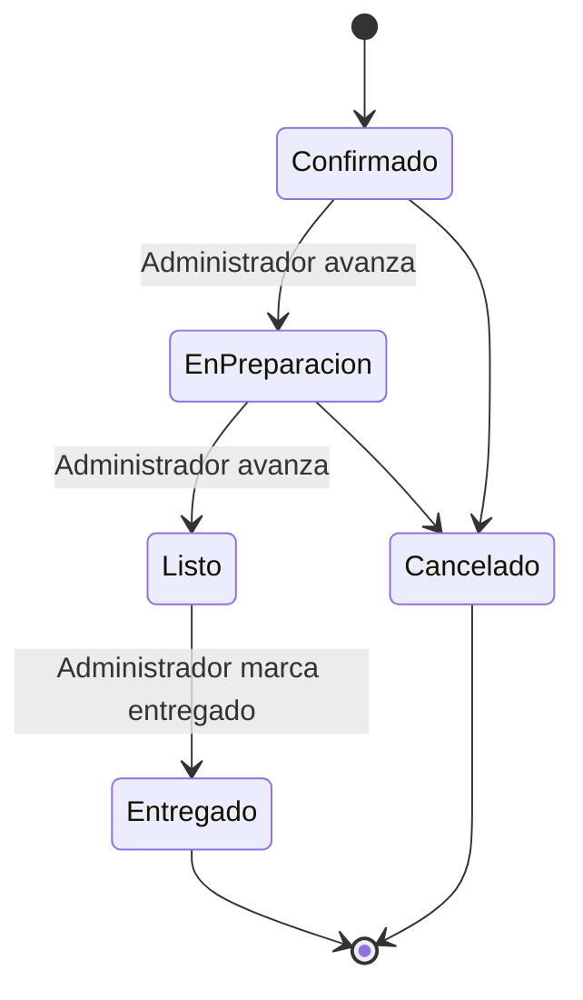
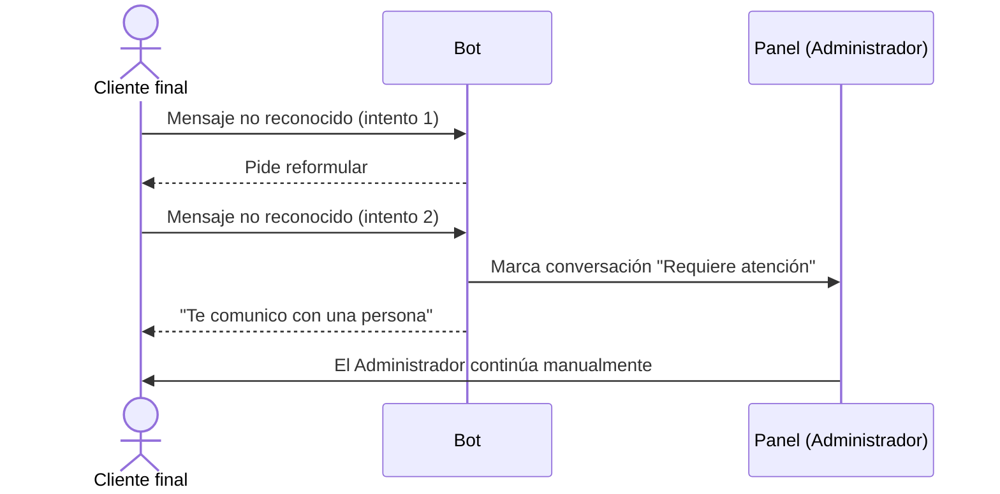
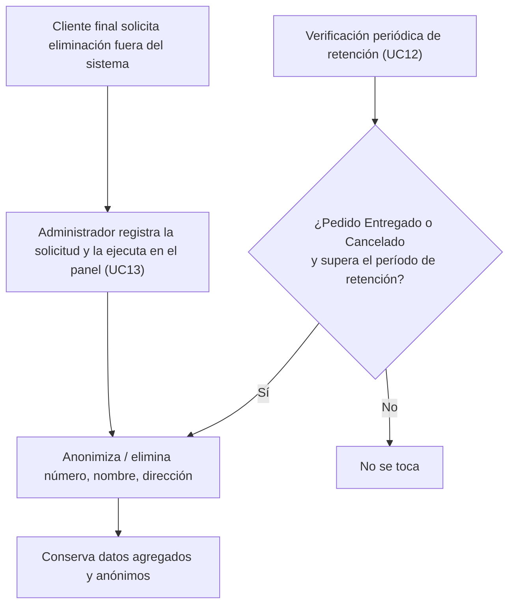

# 02 - Casos de Uso y Flujos

<aside>
🔗

Alineado con **01 - Vision y Requisitos - V1.3**. Segunda revisión: se resuelve el rol Operador (V1 vs V2), se define la regla exacta de turnos, se separa UC04 de UC09 y se limpia EXC-11.

</aside>

## 0. Terminología

| Término | Definición |
| --- | --- |
| **Negocio (Tenant / Business)** | El local que contrata y usa el SaaS. Es la unidad de aislamiento de datos (`tenant_id`). Tiene su propio catálogo, pedidos y usuarios (Administrador, Operador). |
| **Cliente final** | La persona que escribe por WhatsApp para pedir. No es usuario del sistema ni tiene cuenta: interactúa solo a través del bot. No debe confundirse con "Cliente" en el sentido de cliente del SaaS (ese es el Negocio/Tenant). |

Esta distinción importa porque el `tenant_id` aísla **Negocios**, no clientes finales: un cliente final puede escribirle a varios negocios distintos, cada uno con su propio historial de pedidos aislado.

---

## 1. Actores

| Actor | Categoría | Descripción |
| --- | --- | --- |
| **Cliente final** | Humano · externo al negocio | Persona que escribe por WhatsApp para consultar el menú y pedir. No tiene cuenta ni acceso al panel. |
| **Administrador** | Humano · interno al negocio | Única cuenta con acceso al panel en V1: catálogo, pedidos, estadísticas, exportación, traspasos y eliminación de datos. En V2 comparte el panel con el Operador (ver 5.2). |
| **Operador** | Humano · interno al negocio · **V2** | **Decidido:** no existe como cuenta separada en V1. El negocio (1 a 5 empleados) opera con una sola cuenta de Administrador. El rol Operador, con permisos acotados a la cola del día a día, se incorpora en V2 cuando varias personas necesiten atender el panel a la vez. |
| **WhatsApp Business Platform (Meta)** | Sistema externo | Canal de mensajería fuera del control del SaaS. Entrega los webhooks entrantes y los mensajes salientes, y define sus propias reglas (ventana de 24 h, plantillas, precios). |
| **Bot de mensajería** | Componente interno del sistema | No es un actor con voluntad propia: es el componente que interpreta y responde mensajes de WhatsApp en nombre del negocio, ejecutando los flujos automatizados. Se documenta como fila propia porque concentra varios casos de uso. |
| **Panel web** | Componente interno del sistema | Interfaz donde el Administrador (y, desde V2, el Operador) trabaja. No es un actor: es el punto de entrada de sus acciones. |
| **Proceso de retención de datos** | Componente interno del sistema, programado | Proceso interno que aplica la política de retención de RF12 sobre pedidos vencidos. Se documenta como fila propia porque dispara un caso de uso sin intervención humana; el mecanismo concreto (frecuencia, tecnología) es una decisión de implementación, no de este documento (ver 7). |

---

## 2. Casos de Uso

> Columna **Versión**: V1 = must del documento 01 · V2 = should/could, depende de una decisión pendiente relevante, o requiere el rol Operador · Pendiente = su alcance depende de una `[DECISIÓN PENDIENTE]` de la 01 antes de poder construirse tal como está descrito.
> 

| ID | Caso de uso | Actor(es) | Origen (01) | Versión |
| --- | --- | --- | --- | --- |
| UC01 | Consultar menú | Cliente final, Bot | RF01, HU2.1 | V1 |
| UC02 | Armar pedido | Cliente final, Bot | RF06, HU2.3 | V1 |
| UC03 | Confirmar o cancelar pedido | Cliente final, Bot | RF06, RF08, HU2.4 | V1 |
| UC04 | Consultar estado del pedido (cliente pregunta al bot) | Cliente final, Bot | RF09, HU2.5 | V2 (RF09 es Should) |
| UC05 | Traspasar conversación a un humano | Cliente final, Bot, Administrador (Operador en V2) | RF05, HU2.6 | V1 |
| UC06 | Enviar imagen de producto | Cliente final, Bot | RF10, HU1.3 | V2 (RF10 es Should) |
| UC07 | Gestionar catálogo de productos | Administrador | RF04, HU1.1, HU1.2, HU1.3 | V1 |
| UC08 | Monitorear pedidos en tiempo real | Administrador (Operador en V2) | RF03, HU3.1 | V1 |
| UC09 | Avanzar estado del pedido (control interno de la cola) | Administrador (Operador en V2) | RF07, HU3.4 | V1 |
| UC10 | Marcar pedido como entregado | Administrador (Operador en V2) | RF07, HU3.2 | V1 |
| UC11 | Exportar pedidos | Administrador | RF11, HU3.3 | V2 (RF11 es Should) |
| UC12 | Aplicar retención sobre datos vencidos | Proceso de retención de datos | RF12, HU4.1 | V1 (obligatorio por RNF05 / legal) |
| UC13 | Eliminar datos a solicitud del cliente final | Administrador | RF12, HU4.2 | V1 (obligatorio por RNF05 / legal) |

**UC04 vs. UC09 — por qué no es el mismo alcance:** UC09 (mover el pedido de estado en la cola interna) es **V1** porque el negocio necesita ordenar su trabajo sin importar si el cliente puede consultarlo. UC04 (el cliente le pregunta al bot por su pedido) es **V2** porque depende de RF09, que es Should. Es decir: el sistema siempre sabe en qué estado está un pedido (V1); que el cliente pueda preguntárselo al bot es una capa aparte que se agrega después.

**Fuera de V1 (no tienen UC propio todavía):** RF13 (horario de atención y mensaje fuera de horario) queda pendiente de decisión en la 01; si se confirma para V1, se agrega como UC14 antes de pasar a Arquitectura.

---

## 3. Diagrama de Casos de Uso

Flechas punteadas desde Operador = alcance V2. En V1 todas esas acciones las hace el Administrador (única cuenta del negocio).

---

## 4. Descripción de cada Caso de Uso

### UC01 — Consultar menú · V1

**Actor:** Cliente final · **Precondición:** el negocio tiene al menos un producto "Disponible". · **Postcondición:** el cliente recibe la lista de productos disponibles con precios.

**Resumen:** el cliente escribe "Menú" o una variante; el bot filtra los productos "Disponible" y responde con la lista.

### UC02 — Armar pedido · V1

**Actor:** Cliente final · **Precondición:** UC01 realizado o el cliente ya conoce el catálogo. · **Postcondición:** existe un pedido en construcción con ítems, cantidades, modalidad (domicilio/retiro) y, si aplica, dirección.

**Resumen:** el cliente indica productos y cantidades; el bot valida disponibilidad, pregunta modalidad y dirección si corresponde.

### UC03 — Confirmar o cancelar pedido · V1

**Actor:** Cliente final · **Precondición:** UC02 completo, con resumen mostrado. · **Postcondición (confirmar):** se crea el pedido en estado "Confirmado" y se le asigna turno según la regla exacta de 5.3. · **Postcondición (cancelar):** no se crea pedido; se descartan los datos temporales.

### UC04 — Consultar estado del pedido · V2

**Actor:** Cliente final · **Precondición:** el cliente tiene un pedido activo. · **Postcondición:** el cliente conoce el estado actual y su número de turno.

**Relación con UC09:** UC09 (mover el pedido de estado) es V1 y no depende de esto — el negocio rastrea su cola internamente sin importar si el cliente puede preguntarlo. UC04 es la capa opcional, V2, que expone esa información al cliente final.

### UC05 — Traspasar conversación a un humano · V1

**Actor:** Cliente final, Bot, Administrador (Operador en V2) · **Precondición:** el bot no reconoce la intención dos veces seguidas, o el cliente lo pide explícitamente. · **Postcondición:** la conversación queda marcada "requiere atención" en el panel; el bot deja de responder automáticamente en ese chat hasta que un humano la retome.

### UC06 — Enviar imagen de producto · V2

**Actor:** Cliente final · **Precondición:** el cliente pide ver un producto que tiene imagen asociada. · **Postcondición:** el cliente recibe la imagen junto con nombre y precio; si no hay imagen, recibe solo texto.

### UC07 — Gestionar catálogo de productos · V1

**Actor:** Administrador · **Precondición:** sesión iniciada en el panel. · **Postcondición:** el catálogo queda creado, editado, deshabilitado o con imagen asociada, y disponible de inmediato para el bot.

### UC08 — Monitorear pedidos en tiempo real · V1

**Actor:** Administrador (Operador en V2) · **Precondición:** panel abierto en la pantalla de pedidos. · **Postcondición:** los pedidos nuevos aparecen sin recargar la página.

### UC09 — Avanzar estado del pedido · V1

**Actor:** Administrador (Operador en V2) · **Precondición:** existe un pedido en un estado anterior al final. · **Postcondición:** el pedido pasa al siguiente estado del ciclo definido en 5.1. Este caso de uso es independiente de RF09: avanzar el estado no depende de si el cliente puede consultarlo (UC04) ni de si se le notifica; esa capa de comunicación es V2.

### UC10 — Marcar pedido como entregado · V1

**Actor:** Administrador (Operador en V2) · **Precondición:** el pedido está en el último estado antes de "Entregado" (ver 5.1). · **Postcondición:** el pedido pasa a "Entregado" y sale de la cola de trabajo. Un pedido "Cancelado" no puede pasar a "Entregado" (ver EXC-12).

### UC11 — Exportar pedidos · V2

**Actor:** Administrador · **Precondición:** existen pedidos en el rango de fechas elegido. · **Postcondición:** se descarga un archivo CSV/Excel sin datos personales del cliente por defecto.

### UC12 — Aplicar retención sobre datos vencidos · V1

**Actor:** Proceso de retención de datos · **Precondición:** un pedido está "Entregado" o "Cancelado" y superó el período de retención (RF12, `[DECISIÓN PENDIENTE]`). · **Postcondición:** se eliminan o anonimizan los datos personales del pedido; se conservan los datos agregados y anónimos. El mecanismo que dispara esta verificación es una decisión de arquitectura (ver 7).

### UC13 — Eliminar datos a solicitud del cliente final · V1

**Actor:** Administrador · **Precondición:** un cliente final solicitó al negocio, por el canal que sea, la eliminación de sus datos. · **Postcondición:** los datos personales del pedido asociado desaparecen del sistema y de los respaldos según la política de retención.

**Aclaración de flujo:** la solicitud del cliente final llega *fuera* del sistema — no tiene una función propia para pedirla, porque no tiene cuenta. Quien la ejecuta dentro del sistema es siempre el Administrador, buscando el pedido y confirmando la eliminación desde el panel. Ese disparo manual usa el mismo mecanismo interno de anonimización que UC12; conviven porque UC12 es automático y periódico, y UC13 es manual y bajo demanda, pero ninguno de los dos elimina algo que el otro necesite conservar. Ver Flujo D en la sección 5.

---

## 5. Flujos principales

### 5.1 Estados del pedido

Ciclo para V1 (una sola etapa "Listo", sin distinguir retiro de domicilio, consistente con que V1 no gestiona repartidores): `Confirmado → En preparación → Listo → Entregado`, con salida a `Cancelado` desde cualquier estado antes de "Entregado". Separar "Listo para retiro" de "En camino" queda para V2, si el piloto muestra que el negocio distingue mucho ambos momentos.

### 5.2 Permisos Administrador vs. Operador (alcance V2)

Esta matriz describe el reparto de permisos para cuando el rol Operador exista. **En V1 no aplica:** toda acción la realiza el Administrador, única cuenta del negocio (ver 1 y 2).

| Acción | Administrador | Operador (V2) |
| --- | --- | --- |
| Gestionar catálogo (UC07) | Sí | No |
| Monitorear pedidos (UC08) | Sí | Sí |
| Avanzar estado del pedido (UC09) | Sí | Sí |
| Marcar como entregado (UC10) | Sí | Sí |
| Atender traspaso (UC05) | Sí | Sí |
| Exportar pedidos (UC11) | Sí | No |
| Eliminar datos a solicitud (UC13) | Sí | No |
| Configurar cuenta del negocio, usuarios, horarios | Sí | No |

Regla para V2: el **Operador** opera la cola del día a día (pedidos y traspasos); el **Administrador** además configura el negocio y maneja lo sensible (catálogo, exportación, eliminación de datos).

### 5.3 Regla exacta de turnos

- El turno es un número entero secuencial, **único por negocio** (nunca compartido entre negocios distintos).
- Se asigna únicamente al confirmar un pedido (UC03) — nunca antes. Un pedido en construcción o cancelado antes de confirmar no consume turno.
- **Se reinicia en 1 cada día, a las 00:00 hora local del negocio.** Esto resuelve para V1 el punto que quedaba `[DECISIÓN PENDIENTE]` en la 01. Si algún negocio necesitara numeración continua sin reinicio, se evalúa como variante en V2.
- La asignación debe garantizar unicidad incluso si dos confirmaciones llegan al mismo tiempo para el mismo negocio: el sistema nunca entrega el mismo número a dos pedidos (ver EXC-07). Cómo se implementa esa garantía (bloqueo, secuencia de base de datos, etc.) es decisión del documento 04 - Arquitectura, no de este documento.

### Flujo A — Toma de pedido completa (UC01 → UC02 → UC03)

1. El cliente pide el menú (UC01).
2. El bot arma el pedido con el cliente, validando cada producto contra el catálogo (UC02).
3. El bot pide modalidad y, si es domicilio, la dirección.
4. El bot muestra el resumen y pide confirmación (UC03).
5. Al confirmar, el sistema crea el pedido en estado "Confirmado" y le asigna el turno siguiente del día para ese negocio (regla 5.3).
6. El bot informa el turno al cliente.

**Postcondición:** pedido creado, visible de inmediato en el panel (UC08).

### Flujo B — Ciclo de vida del pedido (UC09 → UC10)

En V1 quien avanza el estado es siempre el Administrador; en V2 también el Operador (ver 5.2). Cada cambio de estado (UC09) queda visible en el panel sin recargar (UC08). Marcar "Entregado" (UC10) saca el pedido de la cola de trabajo activa; un pedido "Cancelado" queda fuera del ciclo y no puede pasar a "Entregado" (EXC-12).

### Flujo C — Traspaso a un humano (UC05)

La misma ruta aplica si el cliente escribe directamente "hablar con una persona", sin esperar el segundo intento fallido. En V2, el panel también puede recibirlo el Operador.

### Flujo D — Retención y eliminación de datos (UC12, UC13)

UC12 corre de forma periódica y automática sobre todos los pedidos vencidos; UC13 se dispara una vez, manualmente, sobre un pedido puntual. Ambos terminan en el mismo paso de anonimización, así que no hay riesgo de que uno deshaga lo que el otro ya hizo.

---

## 6. Flujos alternativos y excepciones

> Reformuladas para expresar la garantía que debe cumplir el sistema, no el mecanismo técnico con el que se cumple (ese detalle pasa al documento 04 - Arquitectura y a sus ADR).
> 

| ID | Caso de uso afectado | Excepción | Qué debe garantizar el sistema |
| --- | --- | --- | --- |
| EXC-01 | UC01 | Ningún producto disponible. | El bot informa que no hay productos disponibles por el momento. `[DECISIÓN PENDIENTE]`: ¿dispara traspaso automático? |
| EXC-02 | UC02 | Producto inexistente o "Agotado". | El bot informa que no está disponible, sugiere alternativas del menú y no lo agrega al pedido. |
| EXC-03 | UC02 | Producto se agota a mitad del armado del pedido (otro cliente lo agotó primero). | Al confirmar (UC03), el sistema vuelve a comprobar disponibilidad; si algo ya no está, avisa al cliente antes de crear el pedido. |
| EXC-04 | UC01–UC06 | Mensaje entrante de audio, imagen o ubicación (fuera de alcance V1). | El bot responde pidiendo que el cliente escriba su mensaje en texto. |
| EXC-05 | UC01–UC06 | Mensaje no reconocido por el bot. | Pide reformular; al segundo intento fallido, dispara UC05 (traspaso). |
| EXC-06 | UC03 | Cliente deja el pedido sin confirmar (abandono). | Pasado un tiempo de espera, la conversación se da por abandonada y se descartan los datos temporales. `[DECISIÓN PENDIENTE]`: tiempo exacto. |
| EXC-07 | UC03 | Dos clientes confirman casi al mismo tiempo en el mismo negocio. | Cada pedido debe recibir un turno distinto y consecutivo dentro del mismo negocio, sin importar cuántas confirmaciones lleguen a la vez (regla exacta en 5.3). |
| EXC-08 | Cualquiera que reciba mensajes de WhatsApp | WhatsApp reintenta la entrega de un mensaje que el sistema ya procesó. | El sistema no debe crear un segundo pedido ni enviar una segunda respuesta por un mensaje que ya procesó, aunque WhatsApp lo reenvíe (relacionado con RNF03 de la 01). |
| EXC-09 | UC04, UC09 | Ventana de atención de 24 h cerrada al querer notificar al cliente. | No se envía un mensaje libre fuera de la ventana. `[DECISIÓN PENDIENTE]`: si se usa una plantilla de utilidad de pago para notificar igual. |
| EXC-10 | UC01–UC06 | El negocio está fuera de horario de atención. | El bot envía el mensaje de fuera de horario configurado (RF13 en la 01, si se implementa; ver nota de fuera de V1 en la sección 2). |
| EXC-11 | UC12 | El proceso de retención no logra completarse en un ciclo (por ejemplo, una falla temporal del sistema). | El pedido debe quedar pendiente de purga y volver a intentarse en el siguiente ciclo, sin bloquear otros flujos del sistema mientras tanto. |
| EXC-12 | UC10 | Se intenta marcar como "Entregado" un pedido ya cancelado. | El panel debe impedir la acción: un pedido "Cancelado" no puede avanzar de estado. |

---

## 7. Requisito vs. implementación (nota de alcance de este documento)

Este documento describe **qué** debe garantizar el sistema (casos de uso, flujos, excepciones). Quedan fuera, para el documento **04 - Arquitectura** y sus ADR:

- Cómo se implementa la verificación periódica de UC12 (tarea programada, cola, etc.) → ADR-006/007 según la numeración de la 01.
- Cómo se garantiza la unicidad del turno bajo confirmaciones simultáneas (regla en 5.3, EXC-07) → ADR-001/003.
- Cómo se detecta y descarta un mensaje repetido de WhatsApp (EXC-08) → ADR-006.
- Cómo y cuántas veces se reintenta un proceso que falló (EXC-11) → ADR-006.

Mantener esta separación evita que una decisión de implementación (por ejemplo, cambiar de tarea programada a cola) obligue a reescribir este documento.